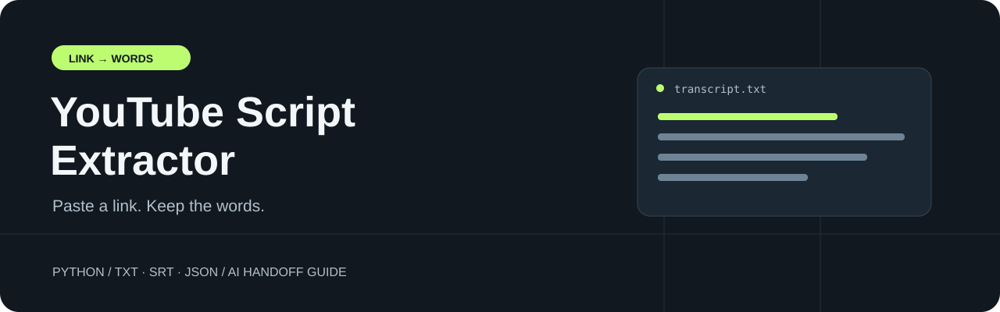

<p align="center">
  
</p>

<p align="center">
  <a href="LICENSE"></a>
  
  <a href="docs/AI-GUIDE.md"></a>
  <a href="https://github.com/thinuka-rgb/youtube-script-extractor/actions/workflows/tests.yml"></a>
</p>

<p align="center"><b>A small Python tool that turns available YouTube captions into a file you can use.</b><br>Made by <a href="https://github.com/thinuka-rgb">Thinuka</a> · No API key · No video download</p>

<p align="center">
  <a href="#start-here">Start here</a> · <a href="#use-it-with-your-ai">Use with AI</a> · <a href="#choose-your-output">Output formats</a> · <a href="#troubleshooting">Troubleshooting</a>
</p>

---

**Website:** [Open the web interface](https://thinuka-rgb.github.io/youtube-script-extractor/) · [Hosting setup and current connection status](docs/WEBSITE.md). The web interface needs a connected Python backend; if it shows “Website preview,” online extraction is not enabled yet.

> **What “script” means here:** the video's available caption transcript, not the creator's original writing document. This tool supports **YouTube links**, not every video website. Missing captions, restrictions, or YouTube request blocking can prevent extraction. It does not transcribe audio.

## Start here

### 1 · Get the files

[**Download the ZIP**](https://github.com/thinuka-rgb/youtube-script-extractor/archive/refs/heads/main.zip), extract it, and open the folder.

Or clone it:

```sh
git clone https://github.com/thinuka-rgb/youtube-script-extractor.git
cd youtube-script-extractor
```

### 2 · Run the launcher

Install [Python 3.10 or newer](https://www.python.org/downloads/) first. On Windows, enable the installer option to add Python to PATH if offered.

| Your computer | What to do in the extracted folder |
| --- | --- |
| Windows | Double-click **`run.bat`** |
| macOS / Linux | Open a terminal there and run **`sh run.sh`** |

The launcher creates a local `.venv`, installs the dependency, then asks for your YouTube link. Internet access is required. Linux users may need their distribution's Python venv package.

### 3 · Paste a link

```text
Paste a YouTube video or Shorts link: https://www.youtube.com/watch?v=pVUgJt1sDmI
```

Your text file is saved inside **`transcripts/`**, beside the Python script. The program prints the selected caption language, whether the captions are manual or automatic, and the saved path.

<details>
<summary><b>Prefer running Python directly?</b></summary>

From the project folder, create a virtual environment:

```sh
python -m venv .venv
```

On macOS/Linux, use `python3` if `python` is unavailable.

**Windows PowerShell**

```powershell
.\.venv\Scripts\python.exe -m pip install -r requirements.txt
.\.venv\Scripts\python.exe youtube_transcript.py "https://www.youtube.com/watch?v=pVUgJt1sDmI"
```

**macOS / Linux**

```sh
.venv/bin/python -m pip install -r requirements.txt
.venv/bin/python youtube_transcript.py "https://www.youtube.com/watch?v=pVUgJt1sDmI"
```

No environment activation is needed. In the examples below, `python` means the interpreter where you installed the dependency; substitute the appropriate `.venv` path above.

</details>

## Use it with your AI

**Download [`youtube_transcript.py`](https://github.com/thinuka-rgb/youtube-script-extractor/releases/latest/download/youtube_transcript.py), attach it to your AI assistant, and paste this:**

```text
Use the attached youtube_transcript.py to retrieve the available captions
for this YouTube link: [PASTE YOUR LINK]

Inspect the script first. If your environment can execute Python and reach
YouTube, install youtube-transcript-api>=1.2.0,<2.0.0 and run the script
with my link. Save the result as a .txt file and give me a download link.
Report the caption language and whether it is manual or automatic.
Keep the caption wording unchanged. Do not invent missing content.

If you cannot run it, access YouTube, or retrieve captions, explain the
actual limitation and give me the local command to run instead.
```

Only the **one `.py` file** needs to be attached; the dependency installation command is included inside it. Uploading a script does not give an assistant Python execution or network access. Your assistant needs both, and YouTube may still block its environment.

[**Read the full AI walkthrough →**](docs/AI-GUIDE.md)

## Choose your output

| Format | Best for | Example |
| --- | --- | --- |
| TXT | Reading or passing captions to an AI | `python youtube_transcript.py "URL"` |
| SRT | Subtitle timestamps and editing | `python youtube_transcript.py "URL" --format srt` |
| JSON | Processing timed caption segments | `python youtube_transcript.py "URL" --format json` |

**Save somewhere specific**

```sh
python youtube_transcript.py "URL" -o "my-transcript.txt"
```

**Choose a caption language**

```sh
python youtube_transcript.py "URL" --languages en
```

By default, the script requests English; if unavailable, it picks the first available caption track. `--languages en si` tries those language codes in order. This selects existing captions; it does not translate them. Within a requested language, the underlying library prefers manual captions when available ([upstream documentation](https://github.com/jdepoix/youtube-transcript-api#manually-created-vs-automatically-generated-transcripts)).

Watch links, Shorts, `youtu.be` share links, embed links, live links, and plain 11-character video IDs are accepted. A live link still needs a retrievable caption track. Quote URLs in terminal commands so characters such as `&` stay part of the link.

Run `python youtube_transcript.py --help` for all options. Existing output files are never silently overwritten: choose a different path with `-o`.

## Troubleshooting

| Message / problem | Next step |
| --- | --- |
| Python is not found | Install Python, reopen the terminal, then check `python --version` (`python3 --version` on macOS/Linux). |
| Install the dependency | Run `python -m pip install -r requirements.txt` using the same interpreter that runs the script. |
| Captions are disabled or unavailable | This tool cannot extract a transcript without available captions. |
| No transcript matches the requested languages | Retry without `--languages`, or choose an available language. |
| YouTube blocked this request/IP | Try locally on your own connection or later. Hosted AI/cloud environments may be blocked; success is not guaranteed. |
| Video is unavailable | Check that the link opens and the video is accessible. |
| File already exists | Pick a new filename with `-o "another-name.txt"`. |
| Text looks incorrect | Inspect the saved UTF-8 file. Caption errors can originate in the source; this tool does not correct wording. |

The upstream project documents [request blocking and cloud-host limitations](https://github.com/jdepoix/youtube-transcript-api#working-around-ip-bans-requestblocked-or-ipblocked-exception). This wrapper does not implement proxies, account login, or audio transcription.

## Inside the repo

```text
youtube_transcript.py   The standalone extractor
requirements.txt        The Python dependency
run.bat / run.sh        Local setup + run launchers
docs/AI-GUIDE.md        Attach-to-AI walkthrough and copyable prompts
tests/                 Offline CLI and caption handling tests
```

To run the offline checks (including the optional web server):

```sh
python -m pip install -r requirements-test.txt
python -m unittest discover -s tests -v
```

## Credits & license

Built on [youtube-transcript-api by Jonas Depoix and contributors](https://github.com/jdepoix/youtube-transcript-api). Its [documentation](https://github.com/jdepoix/youtube-transcript-api#readme) describes the underlying caption service behavior; this repository's source defines this wrapper's options.

Code: [MIT license](LICENSE). That license applies to this tool's code; it does not grant rights to third-party video or caption content. Extracted transcripts are excluded from this repository.
